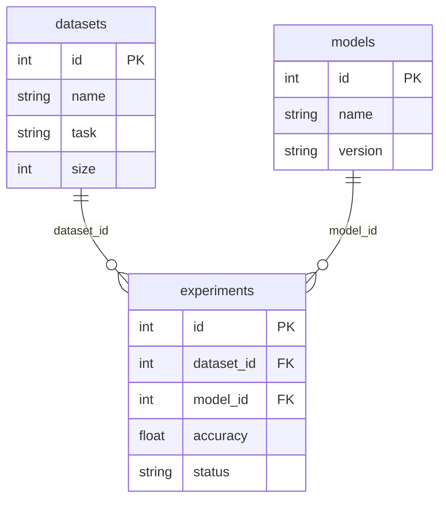

# MiniDB

Собственная файловая мини-СУБД на Python. Данные хранятся в бинарных
файлах собственного формата, без SQLite/ORM/pandas/JSON-хранилищ: только стандартная библиотека.

Предметная область: ML-эксперименты. Три связанные таблицы `datasets`, `models`, `experiments`.

## Запуск

Нужен Python 3.8+. Устанавливать ничего не требуется.

```bash
python3 seed.py          # создать папку data/ с тестовыми данными (5 + 5 + 20 записей)
python3 cli.py           # консольный интерфейс, база берётся из data/
python3 demo.py          # сценарий защиты одним запуском (в папке demo_data/)
```

Тесты (`pytest` нужен только для них):

```bash
pip install pytest
python3 -m pytest        # все тесты
python3 -m tests.test_crud   # или любой отдельный файл без pytest
```

Папка `data/` в репозитории уже содержит готовую базу, `seed.py` пересоздаёт её с нуля.

## Что реализовано

| Требование | Где |
|---|---|
| Файловое хранение, данные переживают перезапуск | `storage.py`, `table.py` |
| 3 таблицы `datasets`, `models`, `experiments` | `seed.py` (`create_tables`) |
| CREATE TABLE: имя, поля, типы, PRIMARY KEY | `Database.create_table`, команда `create` |
| Типы INT, FLOAT, STRING | `types.py` |
| INSERT, SELECT, UPDATE, DELETE | `table.py`, `database.py` |
| SELECT: выбор столбцов, фильтры `= != > < >= <=` | `Table.select`, `query.py` |
| PRIMARY KEY, авто-ID, запрет дубликатов | `Table.insert` |
| Связи `experiments.dataset_id -> datasets.id`, `experiments.model_id -> models.id` | `schema.py`, `database.py` |
| Ссылочная целостность (неверный FK, удаление родителя со ссылками) | `Database._check_fk`, `_check_not_referenced` |
| Обработка ошибок (свои исключения, без traceback в CLI) | `errors.py`, `cli.py` |
| CLI | `cli.py` |
| Тестовые данные | `data/`, `seed.py` |


## CLI

```
tables                                  список таблиц
describe <table>                        столбцы, PK, связи
create <table> <col:TYPE> ... pk=<col> [fk=<col>:<table>.<col>]
insert <table> col=val ...
select <table> [columns a,b] [where col op value]
update <table> set col=val ... where col op value    (или "all" вместо where)
delete <table> where col op value                    (или "delete <table> all")
help, exit
```

Операторы: `= != > < >= <=`. Значения с пробелами берутся в кавычки: `name="Fashion MNIST"`.
`update` и `delete` без `where` запрещены (защита от случайной потери данных), для всей таблицы нужно
явно написать `all`.

```
minidb> select experiments columns id,accuracy where accuracy > 0.9
minidb> insert experiments dataset_id=1 model_id=1 accuracy=0.85 status=running
minidb> update experiments set status=completed where id = 21
minidb> delete experiments where id = 21
minidb> insert experiments dataset_id=99 model_id=1 accuracy=0.5 status=running
Ошибка (IntegrityError): FOREIGN KEY: в datasets нет записи с id=99 (столбец experiments.dataset_id)
```

Создание таблицы из CLI:

```
create projects id:INT name:STRING(32) budget:FLOAT pk=id
create runs id:INT project_id:INT pk=id fk=project_id:projects.id
```

## Использование как библиотеки

```python
from minidb.database import Database

db = Database("data")                                       # открыть/создать базу
db.insert("experiments", {"dataset_id": 1, "model_id": 2,   # id проставится автоматически
                          "accuracy": 0.9, "status": "running"})
db.select("experiments", ["id", "accuracy"], ("accuracy", ">", 0.8))
db.update("experiments", ("id", "=", 3), {"status": "completed"})
db.delete("experiments", ("id", "=", 3))
db.close()
```

Условие это кортеж `(столбец, оператор, значение)`; `None` значит «все записи».

## Архитектура

Слои, каждый знает только про слой ниже:

```
cli.py / demo.py            интерфейс: разбор команд, вывод таблицей
   │
database.py                 набор таблиц, FOREIGN KEY, запрет удалять родителя со ссылками
   │
table.py + query.py         CRUD одной таблицы, PK, условия WHERE
   │
schema.py + types.py        столбцы, запись <-> байты, схема <-> заголовок файла, типы
   │
storage.py                  байты в файле: заголовок + записи фиксированной длины
   │
data/*.tbl                  файлы на диске
```

| Файл | Ответственность |
|---|---|
| `minidb/errors.py` | `MiniDBError` и наследники: `ValidationError`, `StorageError`, `SchemaError`, `IntegrityError` |
| `minidb/types.py` | `INT`, `FLOAT`, `STRING`: `validate`, `pack`, `unpack`, `parse` |
| `minidb/storage.py` | чтение/запись записи по номеру через `seek` |
| `minidb/schema.py` | `Schema`, `Column`, формат заголовка |
| `minidb/table.py` | `Table`: `create`, `open`, `insert`, `select`, `update`, `delete` |
| `minidb/query.py` | операторы сравнения, проверка и вычисление условия |
| `minidb/database.py` | `Database`: таблицы, FK-проверки |
| `minidb/display.py` | вывод результата текстовой таблицей |

Ссылочная целостность живёт в `Database`, а не в `Table`: одна таблица ничего не знает про соседние.

## Формат хранения

База это папка, каждая таблица это один файл `<имя>.tbl`. Список таблиц это список файлов в папке,
схема каждой таблицы лежит в заголовке её файла, поэтому после перезапуска таблица сама знает свою структуру.

```
[ЗАГОЛОВОК 1024 байта][запись 0][запись 1][запись 2]...
смещение записи n = 1024 + n * размер_записи
```

Заголовок:

```
MDB1 (4)  | next_id (8) | число столбцов (1) | индекс PK (1)
столбец:    имя (32) | код типа (1) | длина (2)          (по одному на столбец)
число FK (1), затем на каждую связь: столбец (32) | таблица (32) | столбец в ней (32)
```

Запись: `флаг жива/удалена (1 байт)` и поля по порядку столбцов.

| Тип | Размер | Кодирование |
|---|---|---|
| INT | 8 байт | знаковое целое, little-endian (`struct`, `<q`) |
| FLOAT | 8 байт | double, little-endian (`<d`) |
| STRING(N) | N байт | UTF-8, добивается нулевыми байтами |

Пример: запись `experiments` весит `1 + 8 + 8 + 8 + 8 + 16 = 49` байт, поэтому файл с 20 записями весит
`1024 + 20 * 49 = 2004` байта.

Принятые решения:

- **Фиксированная длина записей**: смещение считается по формуле, UPDATE перезаписывает запись на месте.
- **Мягкое удаление**: DELETE меняет только байт-флаг, файл не сдвигается. Место удалённых записей
  не переиспользуется (чистка файла не реализована).
- **Авто-ID**: счётчик `next_id` хранится в заголовке и не уменьшается, поэтому id удалённой записи
  не выдаётся повторно, в том числе после перезапуска.
- **Порядок записи в INSERT**: сначала все проверки и упаковка (файл не тронут), потом счётчик, потом запись.
  Ошибка типа не оставляет в файле половину записи.
- **UPDATE в две фазы**: сначала упаковываются все новые записи, и только потом пишутся в файл.
- **PRIMARY KEY нельзя менять** через UPDATE.
- Поиск и проверка дубликатов PK пока идут полным проходом по файлу.

## Схема данных

Для dbdiagram.io текст схемы лежит в `docs/schema.dbml`.



## Тестовые данные

`python3 seed.py` создаёт 5 datasets, 5 models и 20 experiments (генератор с фиксированным seed:
данные одинаковы при каждом запуске, первые три эксперимента совпадают с примером из задания).

## Демонстрация

Автоматически: `python3 demo.py`. Вручную через CLI:

```bash
python3 seed.py                 # 1. база и таблицы
python3 cli.py
minidb> tables
minidb> describe experiments
minidb> insert experiments dataset_id=1 model_id=1 accuracy=0.85 status=running    # 2. INSERT
minidb> select experiments                                                          # 3. SELECT всех
minidb> select experiments columns id,accuracy where accuracy > 0.9                # 3. с условием
minidb> update experiments set status=completed where id = 21                      # 4. UPDATE
minidb> delete experiments where id = 21                                           # 4. DELETE
minidb> insert experiments dataset_id=99 model_id=1 accuracy=0.5 status=running    # 5. ошибка FK
minidb> delete datasets where id = 1                                               #    нельзя удалить родителя
minidb> exit
python3 cli.py                  # 6. перезапуск
minidb> select experiments      # изменения на месте, id=21 нет, следующая вставка получит id=22
```

## Тесты

`tests/` содержит проверки по слоям: `test_types`, `test_storage`, `test_table`, `test_crud`
(все операторы, выбор столбцов, UPDATE/DELETE, персистентность), `test_errors` (крайние случаи и повреждённые файлы),
`test_fk` (ссылочная целостность, `seed`), `test_cli` (настоящая сессия через stdin).

## Ограничения

Нет блокировок: с одной базой должен работать один процесс. Нет транзакций и журнала: при аварийном
отключении питания последняя запись может не дойти до диска (`flush` передаёт данные ОС, `fsync` не вызывается).